# HLD / LLD Diagrams — 4×4 Full Architecture

**Sole source:** `FINAL_whitepaper_v3.0.md` (v3.0, Unified Final). Every block, edge, field, state, and
number below is taken from that document. Nothing is invented.

Companion file: `HLD_LLD_2x2_FPGA.md` (FPGA-emulation configuration: 2×2 mesh, formal config, FPGA top,
resource budget, timing constraints). Identical microarchitecture; only parameters and field widths differ.

## Legend

| Marker | Meaning |
|---|---|
| ⚠ | Not specified in the white paper (WP). Shown so it is visible, **not** silently invented. |
| [gated] | DMA content: only built if the Week-8 gate passes (§3.11, §7.1). |
| R1–R4 | Adjudicated rulings given by the document owner during diagram generation (recorded in §13 spirit): |

**R1 — Local same-tile miss path.** An L1 miss on a line homed at its own tile goes
`L1 → intra-tile mux → local L2/directory controller` directly, with **no** router/NIC traversal.
(Directed tests 1 vs 2 distinguish local-home from remote-home exactly this way.)

**R2 — L2 bank access model.** One **single serialized bank port** behind a bank arbiter; all three
sources (local L1 fills, remote NoC requests, memory-tap fills/write-backs) queue. Service/queue order is
**⚠ not specified in WP**.

**R3 — Fill / dirty-data path: bank first, tap on bank miss.** `DIR_MEM_WAIT` reads the L2 data array
first and reads the tap only on a bank miss; `PUTM`/`DATAFWD` write the bank (dirty lives in the bank);
`DIR_EVICT/WRITE_BACK` writes bank → tap; in `DIR_M` the owner's L1 is authoritative and the bank copy is
stale (§3.2 inclusion policy). This is the only reading under which §3.2, §3.9 and Appendix B are all
simultaneously true.

**R4 — Tap is not on the NoC datapath.** `NIC ↔ router` connect **directly**; the memory tap connects only
to the L2 controller (fill / write-back). The legacy §3.9/§3.1 sentence "also passes non-memory packets to
and from the NIC" is treated as superseded wording and is flagged ⚠ wherever the tap appears.

R1–R4 are now normative in the white paper at §3.12 ("Resolved ambiguities"); this file and the WP agree.

## Diagram index

| ID | Title | Level |
|---|---|---|
| HLD-1 | 4×4 mesh system | HLD |
| HLD-2 | CPU tile internal blocks and datapaths | HLD |
| HLD-3 | DMA device tile variant [gated] | HLD |
| HLD-4 | Message / class / VC plane | HLD |
| HLD-5 | Verification environment | HLD |
| LLD-1 | Router microarchitecture (RC/VA/SA/ST, credits, arbitration) | LLD |
| LLD-2 | L1 MESI controller FSM | LLD |
| LLD-3 | Directory controller FSM + DTR | LLD |
| LLD-4 | NIC datapath | LLD |
| LLD-5 | Intra-tile request path and L2 bank access | LLD |
| LLD-6 | Memory tap | LLD |
| LLD-7 | Address decode and stored-tag decomposition (4×4) | LLD |
| LLD-8 | Header flit map and packet framing | LLD |

---

# HLD-1: 4×4 Mesh System

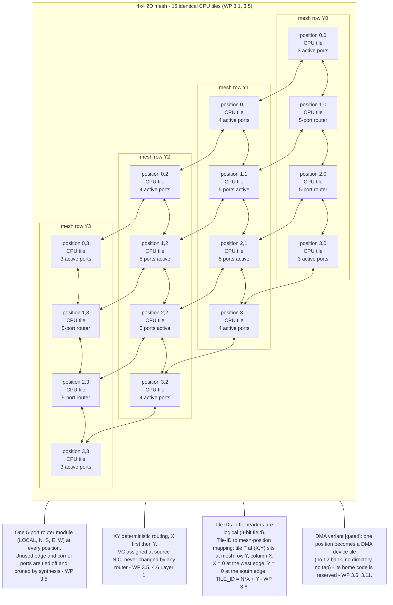

---

# HLD-2: CPU Tile Internal Blocks and Datapaths

The tile contains the eight blocks of §3.1. The four diagram rulings (R1–R4) are drawn explicitly.

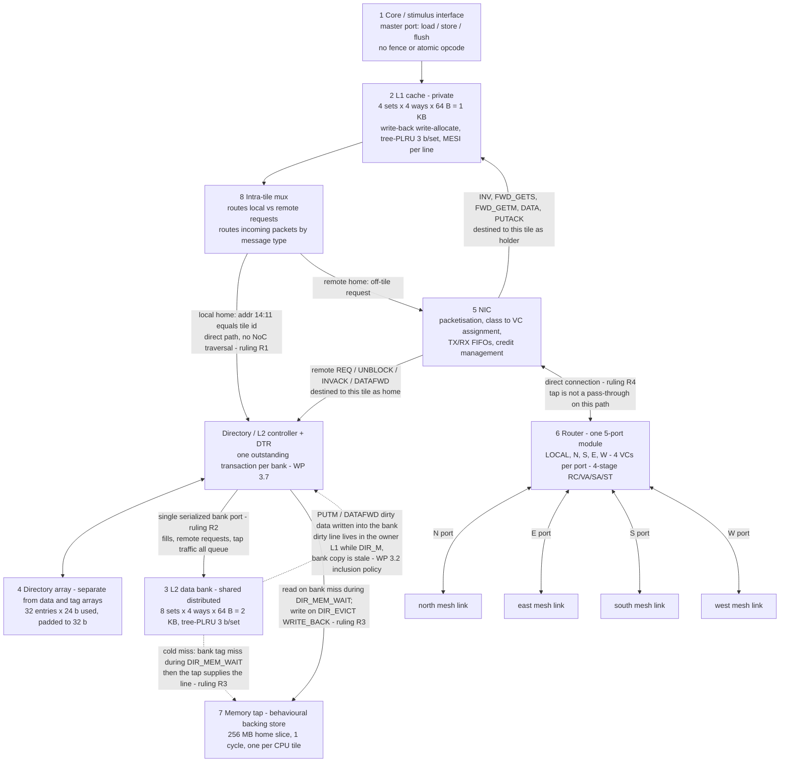

---

# HLD-3: DMA Device Tile Variant [gated] (§3.11, §3.1)

A structural **variant**, not an identical tile: a consumer of coherence, not a provider.

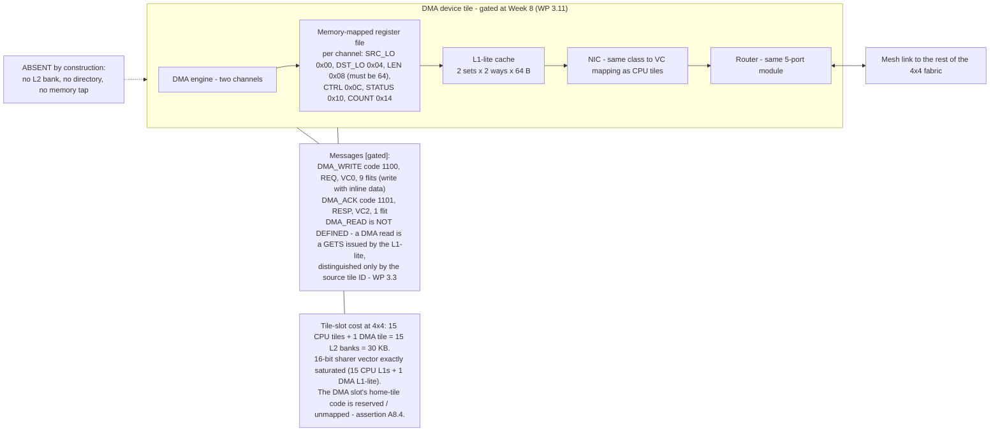

---

# HLD-4: Message / Class / VC Plane (§3.3, §3.5, §4.5, §4.6)

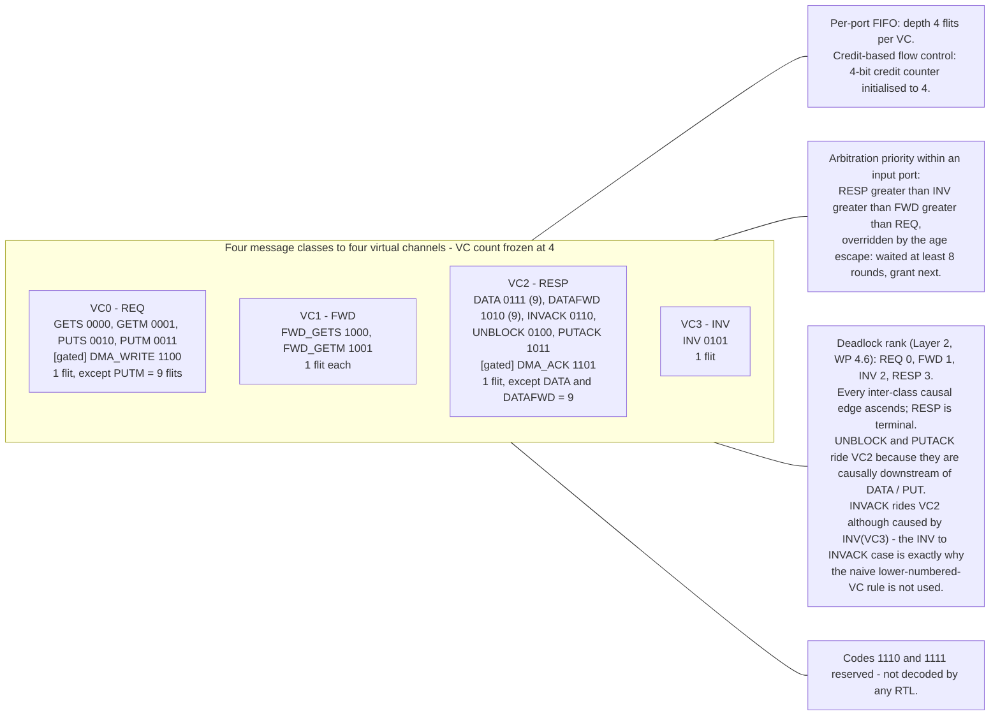

---

# HLD-5: Verification Environment (§5)

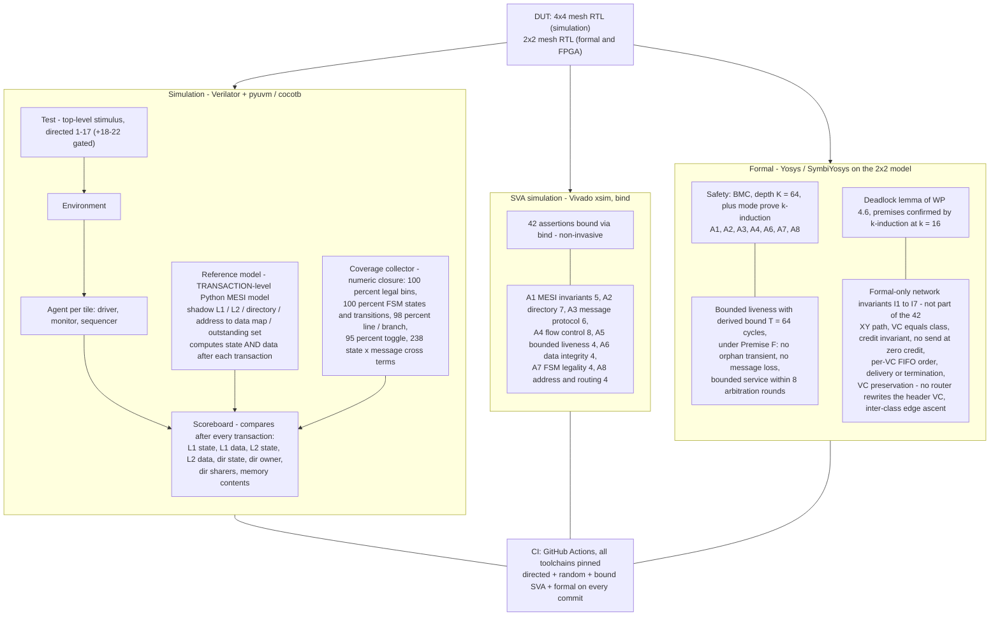

---

# LLD-1: Router Microarchitecture (§3.5, §4.6)

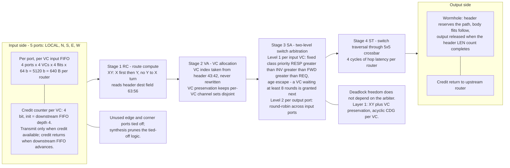

---

# LLD-2: L1 MESI Controller FSM (Appendix A)

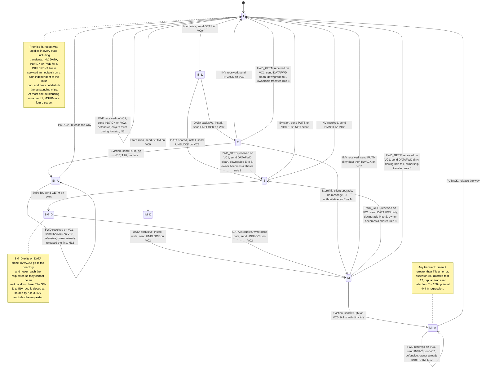

---

# LLD-3: Directory Controller FSM + DTR (Appendix B, §3.3, §3.7)

The 3-bit SRAM state field holds exactly 8 codes. Eviction sub-states and the GETS/GETM discriminator
live in the per-bank **DTR**, not in the SRAM entry. Every transient has **exactly one exit event**.

```mermaid
stateDiagram-v2
    direction TB
    [*] --> DIR_I
    DIR_I --> DIR_MEM_WAIT : GETS, set pending_op GETS, fetch, bank first then tap on miss
    DIR_I --> DIR_MEM_WAIT : GETM, set pending_op GETM, fetch, bank first then tap on miss
    DIR_MEM_WAIT --> DIR_MEM_WAIT : MEM_DATA, send DATA to requester, no state change
    DIR_MEM_WAIT --> DIR_E : UNBLOCK with pending_op GETS, sole clean grant enables silent upgrade
    DIR_MEM_WAIT --> DIR_M : UNBLOCK with pending_op GETM
    DIR_S --> DIR_S : GETS, reply DATA from bank, add sharer, no transient
    DIR_S --> DIR_INV_WAIT : GETM from T, clear T bit, send INV to sharers except T
    DIR_INV_WAIT --> DIR_INV_WAIT : INVACK, clear that sharer bit, idempotent
    DIR_INV_WAIT --> DIR_INV_WAIT : late PUTS from an already INVed tile, bit already clear
    DIR_INV_WAIT --> DIR_INV_WAIT : Sharers equal 0, send DATA exclusive to requester, no state change
    DIR_INV_WAIT --> DIR_M : UNBLOCK with owner T, sole exit event
    DIR_E --> DIR_E : GETS from owner, reply DATA from the home bank
    DIR_E --> DIR_FWD_WAIT : GETS from other, set pending_op GETS, send FWD_GETS; old owner downgrades E/M to S
    DIR_E --> DIR_FWD_WAIT : GETM from other, set pending_op GETM, send FWD_GETM; old owner downgrades to I
    DIR_E --> DIR_I : PUTS from owner, clear Owner, send PUTACK
    DIR_E --> DIR_I : PUTM from owner (silent-upgrade eviction), write data into bank, clear Owner, send PUTACK
    DIR_M --> DIR_M : GETS from owner, reply DATA, owner is authoritative
    DIR_M --> DIR_FWD_WAIT : GETS from other, set pending_op GETS, send FWD_GETS; old owner downgrades M to S
    DIR_M --> DIR_FWD_WAIT : GETM from other, set pending_op GETM, send FWD_GETM; old owner downgrades to I
    DIR_M --> DIR_I : PUTM from owner, write data into bank, clear Owner, send PUTACK
    DIR_FWD_WAIT --> DIR_FWD_WAIT : DATAFWD, write dirty data into the bank, send DATA to requester
    DIR_FWD_WAIT --> DIR_FWD_WAIT : PUTM from owner, satisfies the forward, write bank, set dirty, clear old owner bit, send PUTACK, N12
    DIR_FWD_WAIT --> DIR_FWD_WAIT : PUTS from owner, cancel the forward, bank holds the current value, serve requester from bank, send PUTACK, N12
    DIR_FWD_WAIT --> DIR_FWD_WAIT : INVACK defensive, duplicate release, ignore, no state change, N12
    DIR_FWD_WAIT --> DIR_S : UNBLOCK with pending_op GETS
    DIR_FWD_WAIT --> DIR_M : UNBLOCK with pending_op GETM
    DIR_S --> DIR_S : PUTS from a sharer, clear that bit, send PUTACK
    DIR_S --> DIR_I : PUTS from the last sharer, send PUTACK
    state DIR_EVICT {
        state "victim shared, INV to sharers" as INV_SHARERS
        state "victim owned, INV to owner" as RECALL_OWNER
        state "victim dirty, bank to tap" as WRITE_BACK
        INV_SHARERS --> INV_SHARERS : INVACK, clear that sharer bit
        INV_SHARERS --> WRITE_BACK : final INVACK, victim dirty
        INV_SHARERS --> DIR_MEM_WAIT : final INVACK, victim clean, resolved
        RECALL_OWNER --> WRITE_BACK : PUTM plus INVACK from owner, victim dirty
        RECALL_OWNER --> DIR_MEM_WAIT : final INVACK, victim clean, resolved
        WRITE_BACK --> DIR_MEM_WAIT : bank to tap write committed, proceed with the pending fill
    }
    state "entered from ANY state when a fill requires a victim way" as VictimNeeded
    VictimNeeded --> DIR_EVICT : enter, sub-state chosen by victim directory state (INV_SHARERS if shared, RECALL_OWNER if owned, WRITE_BACK if DIR_I with a dirty bank line, N4)
    note right of DIR_EVICT
        Eviction sub-states NONE, INV_SHARERS, RECALL_OWNER,
        WRITE_BACK are held in the DTR 2-bit field, together
        with evict victim and victim dirty. The 3-bit SRAM
        state field has zero encoding headroom.
    end note
    note left of DIR_FWD_WAIT
        DIR-FWD-WAIT with UNBLOCK has two legal successors;
        DTR pending_op selects DIR-S for GETS or DIR-M for GETM,
        so the transition function is a function.
        Single-exit rule: MEM_DATA, DATAFWD, INVACK and PUTM
        advance DTR progress only and never change the SRAM
        state field on their own.
    end note
```

---

# LLD-4: NIC Datapath (§3.1, §3.3, §3.5, §3.8)

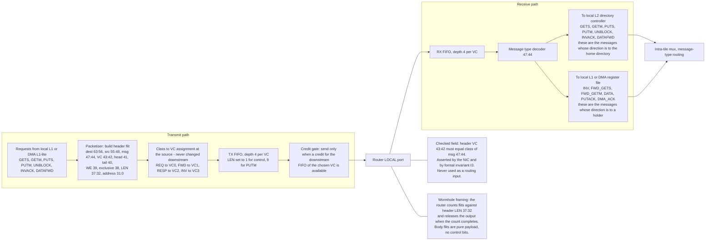

---

# LLD-5: Intra-tile Request Path and L2 Bank Access (§3.1, §3.7, rulings R1–R3)

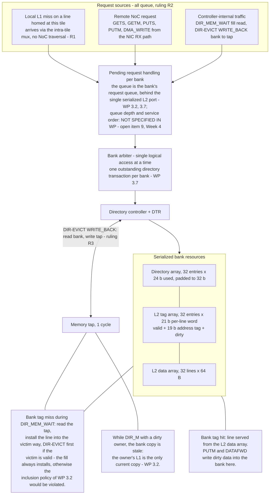

---

# LLD-6: Memory Tap (§3.9, ruling R4)

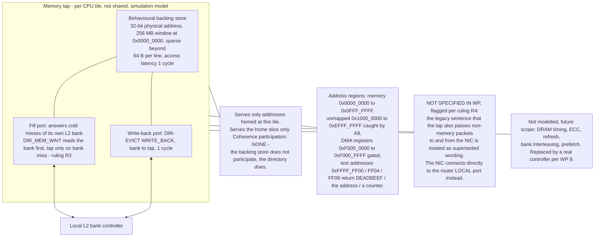

---

# LLD-7: Address Decode and Stored-Tag Decomposition, 4×4 (§3.6)

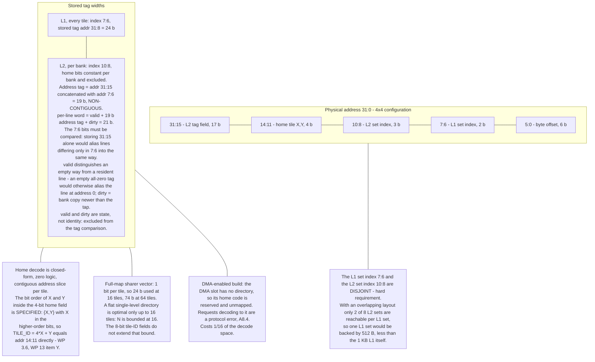

---

# LLD-8: Header Flit Map and Packet Framing (§3.8, Appendix C)

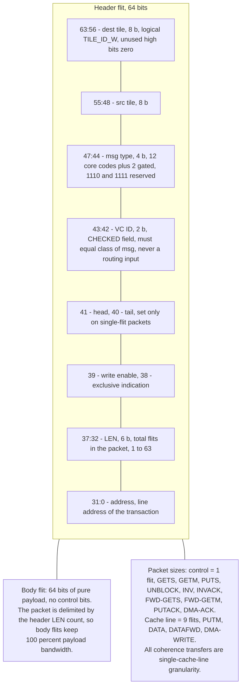

---

*End of 4×4 architecture diagram set. Every ⚠ marker corresponds to a genuine gap in the white paper and
was deliberately not filled in.*
