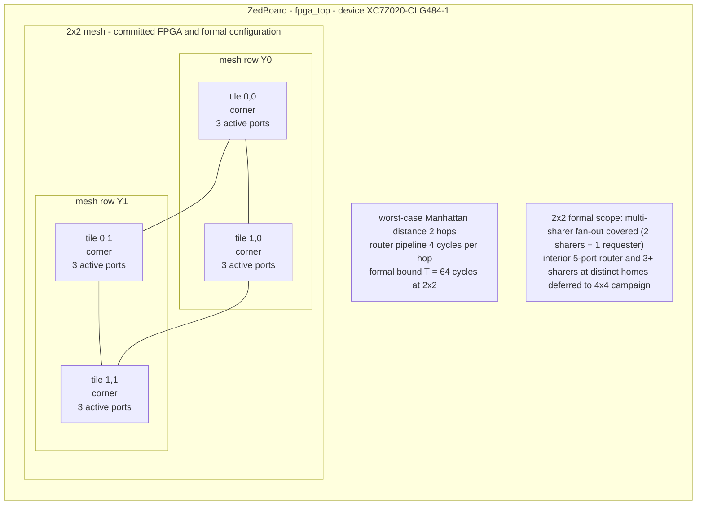
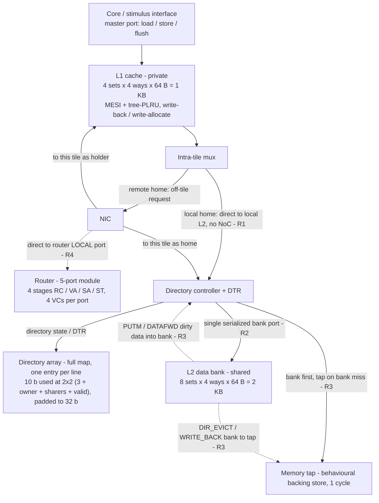

# HLD / LLD — 2x2 Implementation (FPGA)

**Source of truth:** `whitepaper_v3.0.md` (v3.0, Unified Final). Implementation-focused pair for the presentation.

| # | Diagram | Level |
|---|---|---|
| HLD | 2x2 mesh on the committed implementation target (ZedBoard XC7Z020 / `fpga_top`) | HLD |
| LLD | Per-tile internal coherence datapath (MESI, L2 bank, memory tap, rulings R1-R4) | LLD |

Companion sets: `HLD_LLD_4x4_architecture.md` (microarchitecture) and `HLD_LLD_2x2_FPGA.md` (full 2x2 set).

---

## Diagram 1 — HLD: 2x2 mesh on the implementation target

---

## Diagram 2 — LLD: per-tile coherence datapath

*R1-R4 are the adjudicated rulings of WP section 3.12. Items marked not specified in the WP are shown, never invented.*

---

*End of 2x2 implementation presentation diagram pair. shortcut: PPT pair carries only the HLD mesh+FPGA and the LLD intra-tile datapath; resource budget, formal engine detail and FSM views live in the companion files — upgrade path: re-add from `HLD_LLD_2x2_FPGA.md` when the deck widens.*
