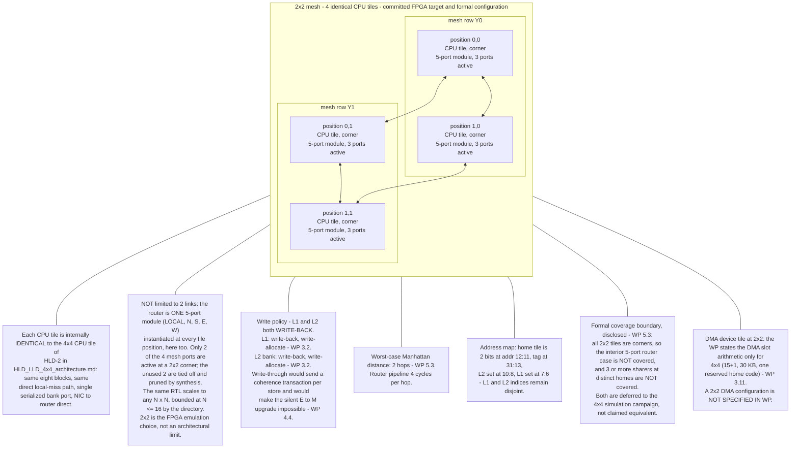
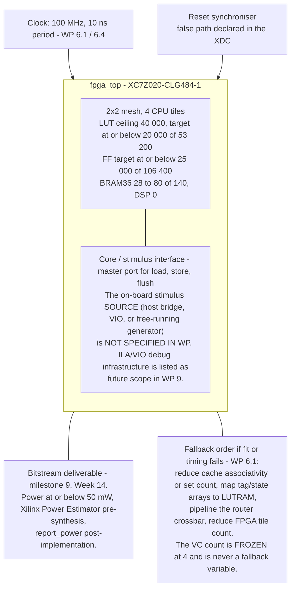
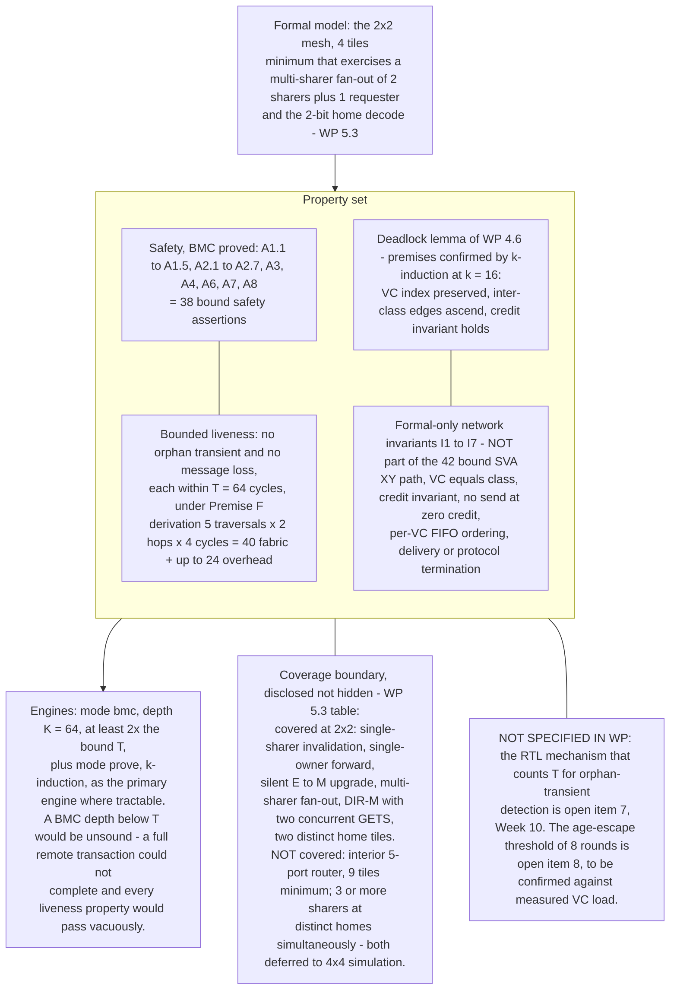
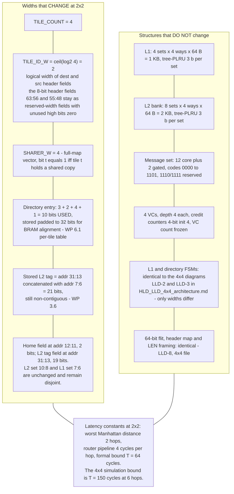
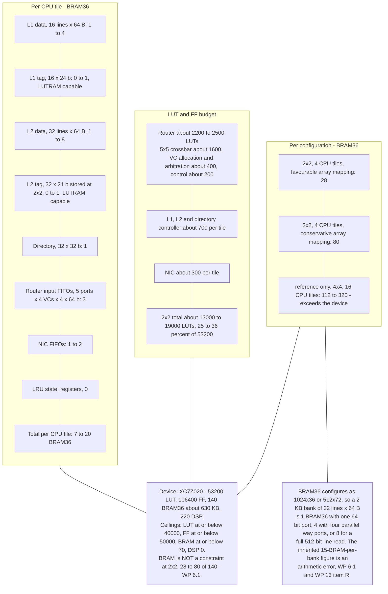
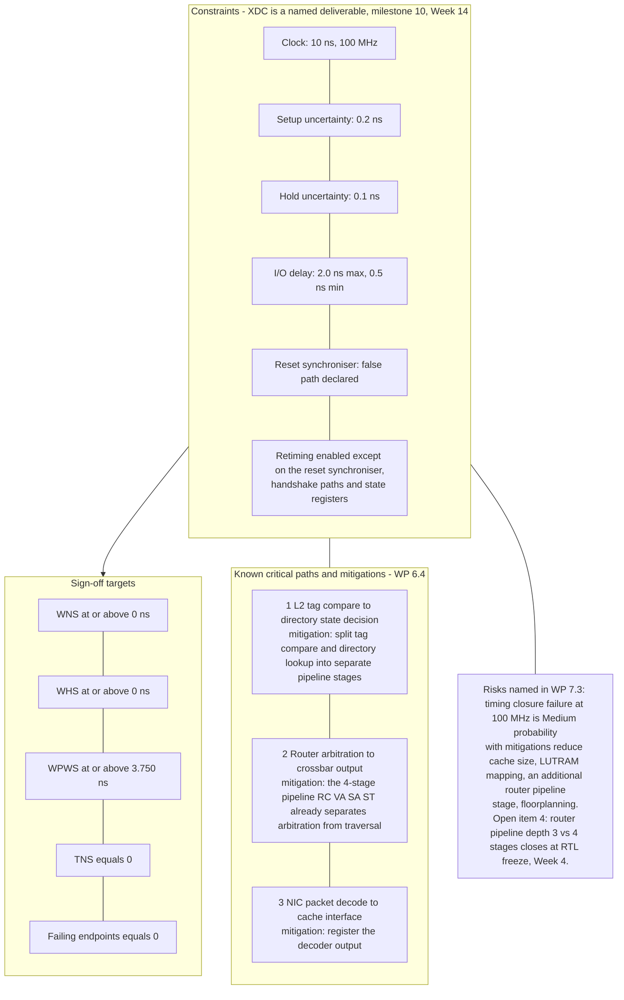

# HLD / LLD Diagrams — 2×2 FPGA Emulation Configuration

**Sole source:** `FINAL_whitepaper_v3.0.md` (v3.0, Unified Final). Companion to
`HLD_LLD_4x4_architecture.md`, which holds the full microarchitecture (router, NIC, L1/directory FSMs,
bank path, tap, flit and address formats). **The RTL is parameterised: at 2×2 only field widths and
counts change, not topology, FSMs, or pipeline structure.** FSM diagrams are therefore referenced, not
duplicated; every 2×2-specific item is derived from §3.6 (2×2 address map), §5.3 (formal configuration),
§6.1 (FPGA target, resource budget), §6.4 (timing closure), and §13 (adjudication ledger).

## Legend

| Marker | Meaning |
|---|---|
| ⚠ | Not specified in the white paper (WP) — shown, never invented. |
| [gated] | DMA content: only built if the Week-8 gate passes (§3.11, §7.1). |

The four adjudicated rulings R1–R4 (local-miss direct path, single serialized bank port, bank-first fill,
NIC↔router direct) are normative in the white paper at §3.12 and are inherited unchanged by the 2×2
configuration.

## Diagram index

| ID | Title | Level |
|---|---|---|
| HLD-F1 | 2×2 mesh (FPGA + formal configuration) | HLD |
| HLD-F2 | FPGA top level, ZedBoard XC7Z020 | HLD |
| HLD-F3 | Formal verification configuration, 2×2 | HLD |
| LLD-F1 | 2×2 parameter deltas vs 4×4 | LLD |
| LLD-F2 | Per-tile and per-configuration resource budget | LLD |
| LLD-F3 | Timing constraint set and critical paths (XDC content) | LLD |

---

# HLD-F1: 2×2 Mesh (FPGA emulation + formal configuration)

All four tiles are **corner tiles**: 3 active ports each (LOCAL + 2 mesh links), from the *same* 5-port
router module with the other two ports tied off (§3.5 — "3" at N=4 in §4.1 is the count of active ports,
not a different router).

---

# HLD-F2: FPGA Top Level, ZedBoard XC7Z020 (§6.1, §6.4, §9)

---

# HLD-F3: Formal Verification Configuration, 2×2 (§5.3, Appendix E)

---

# LLD-F1: 2×2 Parameter Deltas vs 4×4 (§3.2, §3.6, §5.3, §13)

Everything derives from `TILE_COUNT = N²` (§3.6 parameter table).

---

# LLD-F2: Resource Budget, 2×2 (§6.1)

First-order estimate; synthesis must confirm (§12 item 5 — the fit claim stays open until then).

---

# LLD-F3: Timing Constraint Set and Critical Paths, XDC Content (§6.4)

---

*End of 2×2 FPGA diagram set. All FSM and datapath microarchitecture is drawn once, in the 4×4 file;
this file adds only what the WP states uniquely for the 2×2 configuration.*
